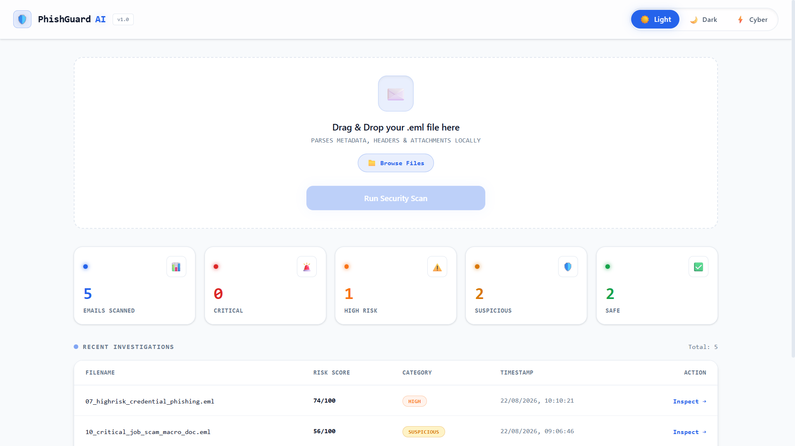
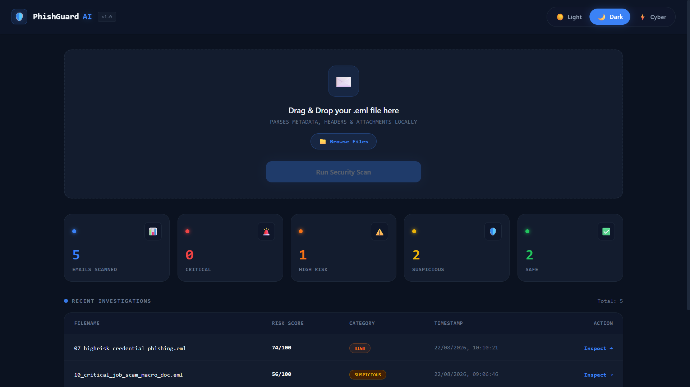
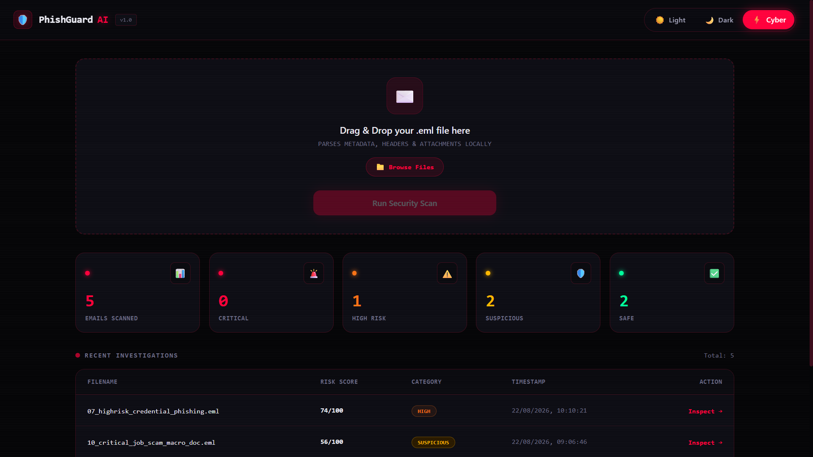
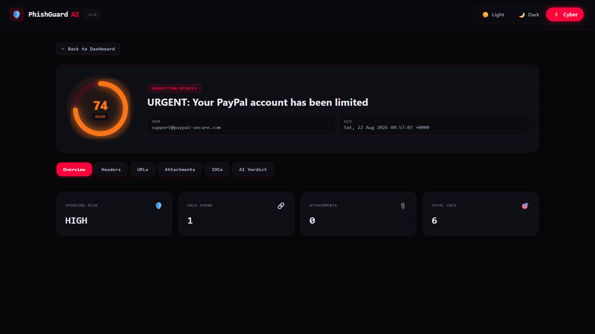
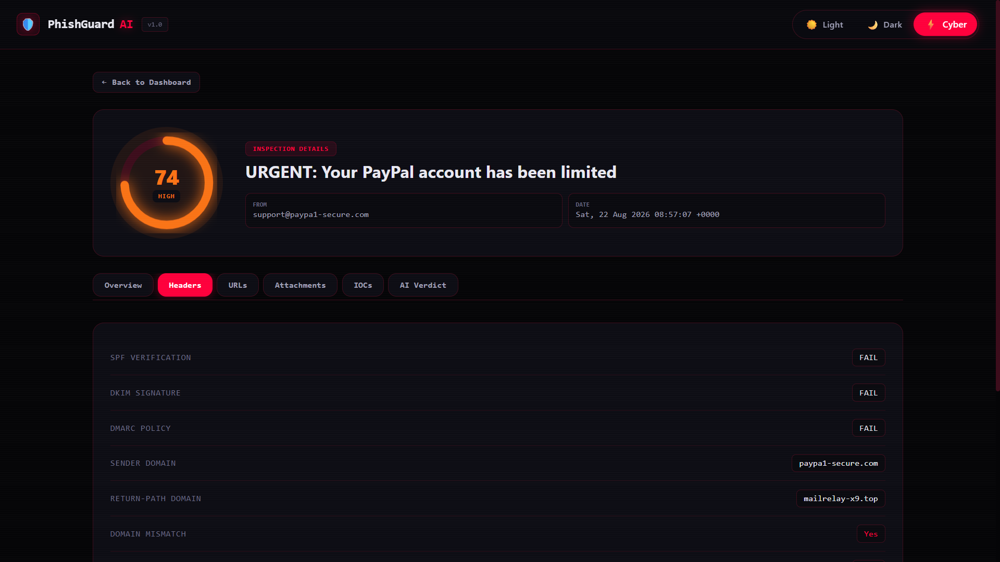
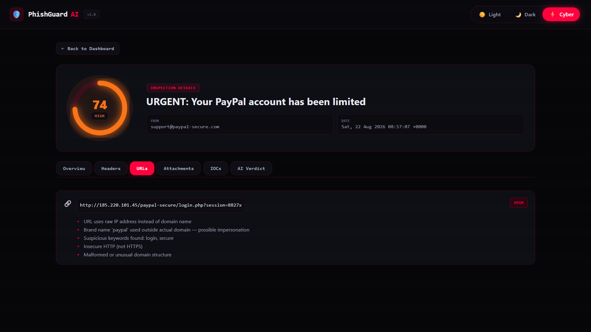
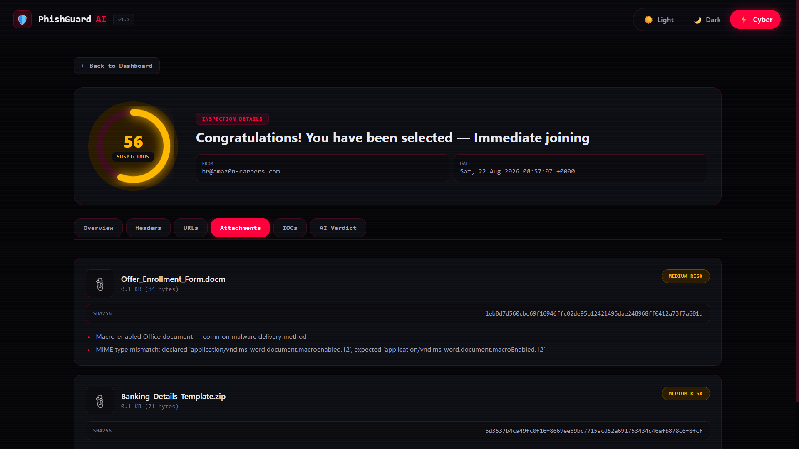
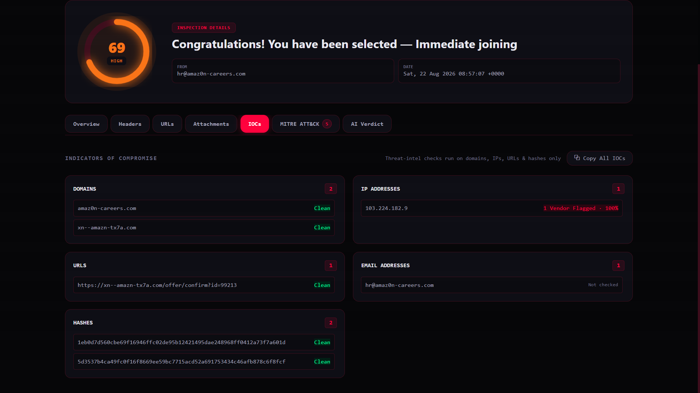
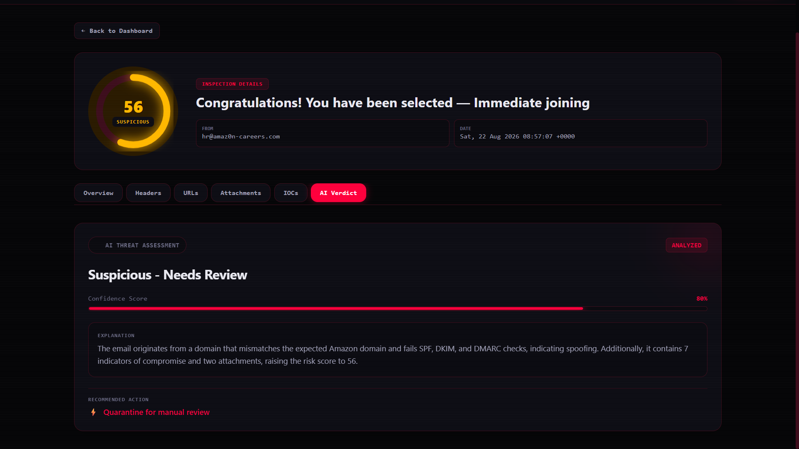
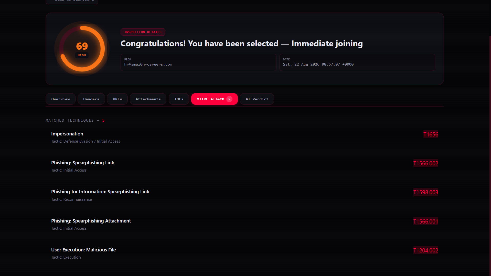

<!-- Attribution (kept per project instructions): Originally forked from sarveshdabke/PhishGuard-AI — MIT license notices preserved in git history. -->
<div align="center">

# Guardian.AI

### AI-Powered Phishing Email Analysis & Investigation Platform

**Detect sender spoofing, malicious URLs, dangerous attachments and phishing indicators — statically, safely, and in seconds. Now with live threat-intelligence lookups and MITRE ATT&CK mapping.**

[](https://www.python.org/)
[](https://fastapi.tiangolo.com/)
[](https://react.dev/)
[](https://tailwindcss.com/)
[](#license)
[](#roadmap)

[Overview](#-overview) •
[Features](#-features) •
[Screenshots](#-screenshots) •
[Architecture](#-architecture) •
[Getting Started](#-getting-started) •
[Roadmap](#-roadmap) •
[Project Theory (Full Doc)](#-project-theory--full-documentation)

<br/>

<!--
  🔗 Live links — Repo & LinkedIn are live.
  Backend (Render) and Frontend (Vercel) links are placeholders —
  update them once deployed, then remove this comment.
-->

[](https://github.com/sarveshdabke/PhishGuard-AI)
[](#)
[](#)
[](https://www.linkedin.com/in/sarvesh-dabke-48437835a)

</div>

---

## 📖 Overview

**Guardian.AI** is a full-stack cybersecurity tool that investigates suspicious emails the way a SOC (Security Operations Center) analyst would — without ever executing untrusted content.

Upload a raw `.eml` file and Guardian.AI runs it through a multi-stage analysis pipeline: header authentication checks (SPF/DKIM/DMARC), URL reputation heuristics, attachment risk scoring, IOC (Indicator of Compromise) extraction, **live threat-intelligence verification against real-world databases**, **MITRE ATT&CK technique mapping**, a deterministic weighted risk engine, and finally an AI reasoning layer that explains *why* an email is dangerous in plain English.

### The Problem

Phishing remains one of the top initial attack vectors in real-world breaches. Most portfolio "email checkers" either:
- Blindly ask an LLM *"is this phishing?"* with no real evidence — unreliable and unexplainable, or
- Only do surface-level keyword matching with no structured investigation trail, or
- Rely purely on local heuristics with no way to confirm whether an indicator has actually been seen as malicious in the real world.

### The Solution

Guardian.AI separates **deterministic security analysis** (headers, URLs, attachments, IOCs) from the **AI reasoning layer**, and — as of V2 — cross-references every extracted indicator against **live, external threat-intelligence sources** before scoring. The AI never guesses — it receives structured, extracted evidence (including real-world reputation data) and produces a grounded, explainable verdict on top of a transparent, weighted risk score. Every finding is auditable, every attachment is analyzed by hash/metadata only (**never executed**), and every score can be traced back to the exact signal that produced it.

### 📘 Project Theory & Full Documentation

This README covers the practical side of the project. For the complete theoretical background — problem statement, system architecture, the theory behind SPF/DKIM/DMARC, URL/attachment heuristics, threat intelligence, MITRE ATT&CK mapping, the risk-scoring model, and a detailed V1 → V2 → V3 roadmap — see the full write-up:

**👉 [Click here to read the Project Theory Document](docs/PhishGuard_AI_Project_Theory.docx)**

---

## ✨ Features

- 📧 **Static `.eml` Parsing** — sender, recipients, subject, body, raw headers, URLs, and attachments extracted without ever executing content
- 🔐 **Sender Authentication Analysis** — SPF, DKIM, DMARC verification + domain/return-path/reply-to mismatch (spoofing) detection
- 🔗 **URL Risk Analysis** — flags IP-based URLs, URL shorteners, punycode/homograph attacks, brand impersonation, insecure HTTP, and suspicious keywords
- 📎 **Attachment Risk Analysis** — dangerous extensions, double-extension disguises, macro-enabled Office docs, archive files, and MIME-type mismatches — SHA-256 hashed, never opened or run
- 🧬 **IOC Extraction** — deduplicated domains, IPs, URLs, email addresses, and file hashes, copyable in one click for threat-intel lookups
- 🌐 **Live Threat Intelligence (V2)** — every extracted domain, IP, URL, and file hash is cross-checked in real time against **VirusTotal**, **AbuseIPDB**, **URLhaus**, and **AlienVault OTX**, with per-IOC verdict badges (Clean / Flagged / Unverified) shown right in the dashboard
- 🗺️ **MITRE ATT&CK Technique Mapping (V2)** — every deterministic finding (spoofing, spearphishing links/attachments, macro payloads, masquerading) is automatically mapped to standard MITRE ATT&CK technique IDs with direct links to the official framework
- ⚖️ **Deterministic Risk Engine** — transparent, documented, weighted scoring (0–100) across sender/URL/attachment/content **and live threat-intel** signals — no black-box scoring
- 🤖 **AI Threat Verdict** — an LLM (via Groq) receives *only* structured evidence (never the raw email) — including confirmed-malicious IOCs and matched MITRE techniques — and returns a classification, confidence score, plain-English explanation, and recommended action, with a safe deterministic fallback if the AI service is unavailable
- 📊 **SOC-Style Investigation Dashboard** — history of past scans, live stats, and a full tabbed breakdown (Overview / Headers / URLs / Attachments / IOCs / MITRE ATT&CK / AI Verdict) per email
- 🎨 **Three Fully Themeable UI Modes** — Light (professional/clean), Dark, and a Cyberpunk "hacker" HUD theme with animated grid backgrounds, glow effects, and a live scanning network animation
- 🧪 **10 Ready-to-Use Sample Emails** — synthetic `.eml` test fixtures spanning Safe → Suspicious → High → Critical risk categories for demoing and QA
- 🛡️ **Fail-Safe Provider Architecture** — each threat-intel source implements a common `ThreatIntelProvider` interface; if any single provider is down, rate-limited, or returns malformed data, the rest of the pipeline keeps working uninterrupted

---

## 🖼️ Screenshots

### Theming — One Codebase, Three Distinct Experiences

<table>
<tr>
<td width="33%">

<p align="center"><b>Light Theme</b></p>
<p align="center"><sub>Clean, professional light UI with the live investigation stats (Critical / High / Suspicious / Safe) and recent-scans table — suited for a corporate/SOC-report look.</sub></p>
</td>
<td width="33%">

<p align="center"><b>Dark Theme</b></p>
<p align="center"><sub>Low-glare dark mode with a subtle animated grid background — the default theme for extended analyst sessions.</sub></p>
</td>
<td width="33%">

<p align="center"><b>Cyberpunk Theme</b></p>
<p align="center"><sub>A HUD-styled "hacker" theme with red/neon accents, clipped panel corners, and glow effects — built to showcase advanced CSS-variable-driven theming.</sub></p>
</td>
</tr>
</table>

### Investigation Breakdown

<table>
<tr>
<td width="50%">

<p align="center"><b>Risk Score Overview</b></p>
<p align="center"><sub>The Overview tab for a scanned email — shows the final 0–100 risk gauge, risk category, sender/date metadata, and quick counts of URLs, attachments, IOCs, and confirmed-malicious indicators.</sub></p>
</td>
<td width="50%">

<p align="center"><b>SPF / DKIM / DMARC Header Analysis</b></p>
<p align="center"><sub>Sender authentication breakdown — SPF, DKIM, and DMARC pass/fail results plus sender-domain vs. return-path mismatch detection used to flag spoofing.</sub></p>
</td>
</tr>
<tr>
<td width="50%">

<p align="center"><b>URL Risk Analysis</b></p>
<p align="center"><sub>Every URL extracted from the email, individually scored with plain-English reasons — e.g., raw-IP links, brand impersonation, or insecure HTTP.</sub></p>
</td>
<td width="50%">

<p align="center"><b>Attachment Risk Analysis</b></p>
<p align="center"><sub>Attachment metadata and SHA-256 hashes with risk flags such as macro-enabled documents or MIME-type mismatches — files are never opened or executed.</sub></p>
</td>
</tr>
<tr>
<td width="50%">

<p align="center"><b>IOC Extraction + Live Threat Intelligence (V2)</b></p>
<p align="center"><sub>Every extracted domain, IP, and URL now shows a real-time verdict badge from VirusTotal, AbuseIPDB, URLhaus, and AlienVault OTX — Clean, Flagged (with vendor count & confidence), or Unverified.</sub></p>
</td>
<td width="50%">

<p align="center"><b>AI Threat Verdict</b></p>
<p align="center"><sub>The AI reasoning layer's output — classification, confidence score, and a plain-English explanation grounded strictly in the structured evidence it was given, now including live threat-intel and MITRE findings.</sub></p>
</td>
</tr>
<tr>
<td width="50%">

<p align="center"><b>MITRE ATT&CK Technique Mapping (V2)</b></p>
<p align="center"><sub>Deterministic findings — spoofing, spearphishing links/attachments, malicious macros, masquerading — automatically mapped to standard MITRE ATT&CK technique IDs, each linking to the official framework page.</sub></p>
</td>
<td width="50%"></td>
</tr>
</table>

---

## 🏗️ Architecture

```text
                    ┌──────────────────┐
                    │   Upload .EML     │
                    └────────┬─────────┘
                             ↓
                    ┌──────────────────┐
                    │   Email Parser    │
                    └────────┬─────────┘
                             ↓
       ┌─────────────────────┼─────────────────────┐
       ↓                     ↓                      ↓
Header Analyzer        URL Analyzer         Attachment Analyzer
 (SPF/DKIM/DMARC)     (reputation heuristics)  (hash, no execution)
       └─────────────────────┼─────────────────────┘
                             ↓
                    ┌──────────────────┐
                    │  IOC Extractor    │
                    └────────┬─────────┘
                             ↓
                    ┌──────────────────────────┐
                    │  Threat Intel Providers   │  ← V2: VirusTotal, AbuseIPDB,
                    │  (parallel, fail-safe)    │     URLhaus, AlienVault OTX
                    └────────┬─────────────────┘
                             ↓
                    ┌──────────────────┐
                    │  MITRE Mapper     │  ← V2: maps findings to ATT&CK IDs
                    └────────┬─────────┘
                             ↓
                    ┌──────────────────┐
                    │   Risk Engine     │  ← deterministic, weighted (0-100),
                    │                   │     now includes threat-intel signal
                    └────────┬─────────┘
                             ↓
                    ┌──────────────────┐
                    │   AI Analyzer     │  ← structured evidence only,
                    │                   │     now includes threat-intel + MITRE
                    └────────┬─────────┘
                             ↓
                    ┌──────────────────┐
                    │  React Dashboard  │
                    └──────────────────┘
```

### Tech Stack

| Layer | Technology |
|---|---|
| **Frontend** | React 19, Vite, Tailwind CSS 4, React Router, Axios |
| **Backend** | Python, FastAPI, Pydantic |
| **Database** | SQLite |
| **AI Layer** | Groq API (OpenAI GPT-OSS models) |
| **Email Parsing** | Python standard `email` library |
| **Threat Intelligence (V2)** | `httpx` (async), VirusTotal API, AbuseIPDB API, URLhaus API, AlienVault OTX API |

---

## 📁 Project Structure

```text
guardian-ai/
│
├── backend/
│   ├── app/
│   │   ├── main.py                    # FastAPI entrypoint, CORS, router registration
│   │   ├── config.py                  # Settings, risk weights, thresholds, threat-intel keys
│   │   ├── database.py                # SQLite connection + schema
│   │   │
│   │   ├── api/
│   │   │   ├── upload.py              # POST /api/upload (.eml)
│   │   │   ├── analyze.py             # POST /api/analyze/{id}, GET /api/analyses
│   │   │   ├── investigate.py         # POST /api/investigate (URL)
│   │   │   ├── messages.py            # POST /api/analyze-message (SMS/text)
│   │   │   └── reports.py             # /api/reports list/get/register/verify
│   │   │
│   │   ├── services/                  # Core analysis pipeline (one stage per file)
│   │   │   ├── email_parser.py
│   │   │   ├── header_analyzer.py
│   │   │   ├── url_analyzer.py
│   │   │   ├── attachment_analyzer.py
│   │   │   ├── ioc_extractor.py
│   │   │   ├── risk_engine.py
│   │   │   ├── ai_analyzer.py
│   │   │   ├── mitre_mapper.py         # V2: maps findings → MITRE ATT&CK IDs
│   │   │   │
│   │   │   └── threat_intel/           # V2: pluggable threat-intel providers
│   │   │       ├── base.py             # Abstract ThreatIntelProvider interface
│   │   │       ├── virustotal.py
│   │   │       ├── abuseipdb.py
│   │   │       ├── urlhaus.py
│   │   │       ├── otx.py
│   │   │       └── provider_manager.py # Orchestrates parallel, fail-safe lookups
│   │   │
│   │   └── models/
│   │       └── schemas.py             # Pydantic response/request models
│   │
│   ├── sample_emails/                 # 10 synthetic test .eml files (Safe → Critical)
│   └── tests/
│
├── frontend/
│   ├── src/
│   │   ├── components/                # UploadBox, RiskGauge, tab components,
│   │   │                               # ThemeToggle, ThreatIntelBadge (V2), MitreTab (V2)
│   │   ├── pages/                     # Dashboard, AnalysisDetail
│   │   ├── context/                   # ThemeContext (Light/Dark/Cyberpunk)
│   │   └── services/api.js            # Axios client
│
├── docs/
│   ├── PhishGuard_AI_Project_Theory.docx
│   └── screenshots/                   # README image assets
│
└── README.md
```

---

## 🚀 Getting Started

### Prerequisites

- Python 3.11+
- Node.js 18+
- A free [Groq API key](https://console.groq.com/) (optional — the app degrades gracefully to rule-based verdicts without it)
- Free API keys for threat intelligence (all optional — the app degrades gracefully, feature by feature, if any are missing):
  - [VirusTotal](https://www.virustotal.com/gui/join-us)
  - [AbuseIPDB](https://www.abuseipdb.com/register)
  - [AlienVault OTX](https://otx.alienvault.com/)
  - URLhaus requires **no API key** (open API)

### 1. Clone the repository

```bash
git clone https://github.com/sarveshdabke/PhishGuard-AI.git
cd guardian-ai
```

### 2. Backend setup

```bash
cd backend
pip install -r requirements.txt

# Copy the example env file and add your own API keys
cp .env.example .env
# then edit .env and add:
#   GROQ_API_KEY, VIRUSTOTAL_API_KEY, ABUSEIPDB_API_KEY, OTX_API_KEY

uvicorn app.main:app --reload
```

Backend runs at `http://127.0.0.1:8000` — interactive API docs at `http://127.0.0.1:8000/docs`.

### 3. Frontend setup

```bash
cd frontend
npm install
npm run dev
```

Frontend runs at `http://localhost:5173`.

### 4. Try it out

Upload any of the 10 sample `.eml` files from `backend/sample_emails/` — they cover the full spectrum from clean, authenticated emails to critical multi-vector phishing attempts with malicious attachments. Each scan now also runs live threat-intel lookups and MITRE ATT&CK mapping automatically.

---

## 🔌 API Endpoints

| Method | Endpoint | Purpose |
|---|---|---|
| `GET` | `/` | Service info / health |
| `POST` | `/api/upload` | Upload a raw `.eml` file |
| `POST` | `/api/analyze/{email_id}` | Analyze an uploaded email |
| `GET` | `/api/analyses` | List analyses |
| `GET` | `/api/analyses/{email_id}` | Get analysis by email id |
| `POST` | `/api/investigate` | Investigate a URL (`{"url":"..."}`) |
| `POST` | `/api/analyze-message` | Analyze SMS/text (`{"text":"..."}`) |
| `GET` | `/api/reports` | List stored reports |
| `GET` | `/api/reports/{report_id}` | Get a report |
| `POST` | `/api/reports/{report_id}/register` | Anchor report hash + risk class on local chain |
| `GET` | `/api/reports/{report_id}/verify` | Verify report integrity on-chain |

Interactive docs: `http://127.0.0.1:8000/docs`.

## 🧪 Six Test Cases

All `risk_class` values must be one of: `Low Risk`, `Suspicious`, `High Risk`, `Confirmed Malicious`, `Inconclusive`.

| Case | Input | Expected |
|---|---|---|
| Suspicious URL | `POST /api/investigate` `{"url":"https://testsafebrowsing.appspot.com/s/phishing.html"}` | High Risk or Confirmed Malicious |
| Homograph | `POST /api/investigate` `{"url":"https://аpple.com"}` (Cyrillic `а`) | Flagged; homograph indicator present |
| Fake SBI KYC SMS | `POST /api/analyze-message` `{"text":"Dear customer, your SBI account will be blocked today. Verify KYC now at http://sbi-kyc-verify.xyz/login"}` | High Risk or Confirmed Malicious |
| Benign | `POST /api/investigate` `{"url":"https://www.google.com"}` | Low Risk |
| Benign | `POST /api/investigate` `{"url":"https://www.github.com"}` | Low Risk |
| Benign (real bank) | `POST /api/investigate` `{"url":"https://www.sbi.co.in"}` | Low Risk (no false positive) |

See [TESTING.md](TESTING.md) for actual results from the verification run.

---

## ⛓️ Web3 Verification (On-Chain Threat Registry)

Every report can be anchored on a **reproducible local Ethereum chain**, so anyone holding a copy
of a report can prove it is the report that was analysed. Only two things are written on-chain:
the **SHA-256 hash of the report's canonical JSON** and its **risk class**. URLs, message text,
email bodies, phone numbers and every other piece of personal data stay in SQLite.

```bash
cd blockchain
npm install

# Terminal 1 - leave the node running for the whole demo
npx hardhat node

# Terminal 2 - deploy to that node
npx hardhat run scripts/deploy.js --network localhost
```

The deploy script prints the deployed contract address and writes the address + ABI to
`backend/contract.json`. The backend reads that file at runtime — the address is never hardcoded,
because every fresh `npx hardhat node` starts an empty chain at a new state.

**Verification evidence (this run, local Hardhat chain 31337):**
- **Deployed contract address:** `0xCf7Ed3AccA5a467e9e704C703E8D87F634fB0Fc9`
- **Example transaction hash (register):** `0xa715dd711eebe9702163db7fd2f4e884cb9628427ce57bb498dc1159a205bd6a` (report `8f410c34-9919-4473-8018-95549c586022`, `verdict="Low Risk"`, `verify exists=True`)

> **The local chain is ephemeral.** It resets the moment `npx hardhat node` stops, so keep the node
> running for the demo and record the contract address and transaction hash of the submission you
> want to show — after a restart they no longer exist (redeploy and re-register as needed).

---

## 🔒 Security Design Principles

- **Never execute untrusted content.** Attachments are analyzed by filename, MIME type, and SHA-256 hash only — payloads are never opened, run, or rendered.
- **AI never invents evidence.** The AI layer receives a structured JSON evidence object derived from deterministic analysis and live threat-intel results — it explains findings, it doesn't generate them.
- **Fail-safe by design.** If the AI service or any individual threat-intel provider is unavailable or rate-limited, the pipeline still returns a complete, rule-based risk verdict instead of failing — no single external dependency can take down the analysis.

---

## ⚠️ Known Limitations

- **Free-tier rate limits.** VirusTotal, AbuseIPDB, and AlienVault OTX free tiers impose daily/per-minute request caps. The app checks a limited number of IOCs per type per email (configurable via `MAX_IOC_CHECK_PER_TYPE`) to stay well within free-tier limits for demo/portfolio-scale usage.
- **Third-party provider outages are outside this project's control.** For example, URLhaus (abuse.ch) has occasionally returned SSL certificate errors on their end — Guardian.AI detects this, reports it clearly as "provider unavailable," and continues the analysis using the remaining providers rather than failing.
- **SQLite on free-tier hosting is ephemeral.** On platforms like Render's free tier, the database and uploaded files reset on redeploy/restart — acceptable for a demo, but not intended for persistent production use without a paid disk.

---

## 🗺️ Roadmap

- [x] **V1** — Static email parsing, header/URL/attachment analysis, IOC extraction, deterministic risk engine, AI verdict layer, themeable SOC dashboard
- [x] **V2** — Live threat intelligence integration (VirusTotal, AbuseIPDB, URLhaus, AlienVault OTX) with a fail-safe, pluggable provider architecture; MITRE ATT&CK technique mapping; risk-engine recalibration to properly weight confirmed-malicious threat-intel signals
- [ ] **V3** — Exportable PDF investigation reports, authentication, analyst notes, IOC search/filtering, Docker-based deployment

---

## 🤝 Contributing

Issues and pull requests are welcome. If you spot a false positive/negative in the risk engine or want to add a new detection heuristic or threat-intel provider, feel free to open an issue.

## 📄 License

Distributed under the MIT License. See `LICENSE` for more information.

## 👤 Author

**Sarvesh Dabke**

Built as a hands-on cybersecurity + full-stack portfolio project — demonstrating Python/FastAPI backend engineering, React frontend design, deterministic security scoring, live threat-intelligence integration, and applied AI reasoning in a single, real-world-style security tool.

[](https://www.linkedin.com/in/sarvesh-dabke-48437835a)
[](https://github.com/sarveshdabke/PhishGuard-AI)

---

<div align="center">

**⭐ If you find this project useful, consider giving it a star — it helps others discover it too.**

</div>